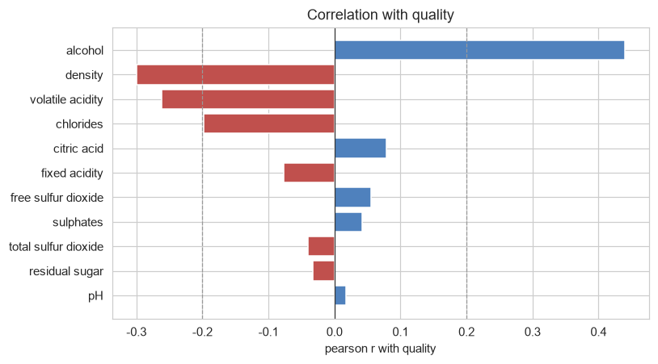
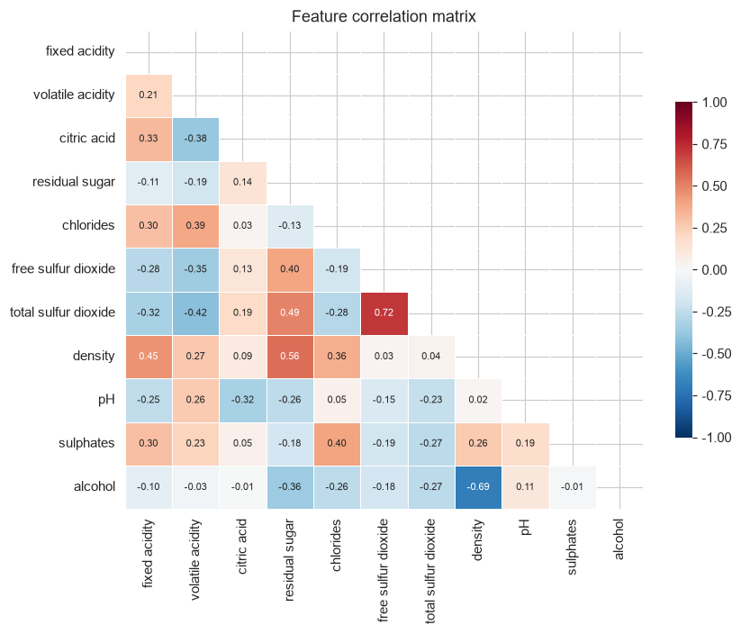
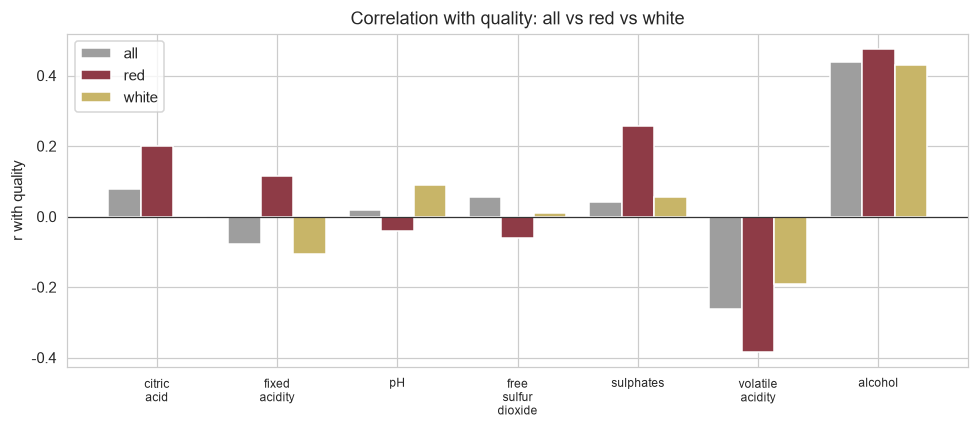
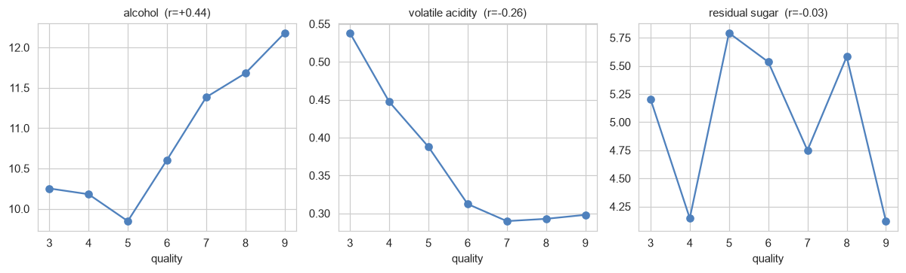

# 와인 품질 분류 — 변수 간 상관 EDA

ESAA YB 미니 프로젝트(2) — YB 2조 · 담당: 변수 간 상관

**데이터**: DACON 와인 품질 분류 (`train.csv` 5,497병, `test.csv` 1,000병)
**목표**: 11개 화학 성분과 와인 타입(red/white)이 품질 등급(3~9점)과 어떤 관계인지, 그리고 변수끼리 얼마나 겹치는지를 확인해 전처리 방향을 정한다.

결측값은 없고, 타입은 white 4,159병 / red 1,338병이다. 검증은 모두 `StratifiedKFold(5, shuffle=True, random_state=42)` 기준이며, 성능 비교에 쓴 모델은 `RandomForestClassifier(n_estimators=300, random_state=42)`로 고정했다.

확인하려는 것은 네 가지다.

1. 품질과 상관이 있는 변수는 무엇인가
2. 상관이 약한 변수는 버려도 되는가
3. 변수끼리 겹치는 구조가 있는가 (파생변수·변수 제거의 근거)
4. 선형 상관계수가 놓치고 있는 관계가 있는가

---

## 1. 품질과 각 변수의 상관

피어슨(선형 관계)과 스피어만(순위 관계)을 같이 봤다. 품질은 3~9점의 순서가 있는 등급이라 스피어만도 의미가 있고, 두 값이 많이 다르면 관계가 직선이 아니거나 극단값이 끼어 있다는 신호다.

| 변수 | pearson | spearman | 차이 |
|---|---|---|---|
| alcohol | **+0.440** | +0.444 | +0.004 |
| density | **−0.300** | −0.321 | −0.021 |
| volatile acidity | **−0.262** | −0.252 | +0.009 |
| chlorides | **−0.198** | −0.292 | **−0.094** |
| citric acid | +0.079 | +0.099 | +0.020 |
| fixed acidity | −0.077 | −0.097 | −0.020 |
| free sulfur dioxide | +0.056 | +0.089 | +0.033 |
| sulphates | +0.042 | +0.035 | −0.007 |
| total sulfur dioxide | −0.040 | −0.052 | −0.013 |
| residual sugar | −0.033 | −0.014 | +0.019 |
| pH | +0.018 | +0.033 | +0.015 |

**선형 상관이 뚜렷한 변수는 네 개뿐이다.** 알코올이 높고 밀도·휘발산·염화물이 낮으면 좋은 등급이다. 나머지 일곱 개는 |r| ≤ 0.08로, 선형 상관만 보면 거의 무관해 보인다.

눈에 걸리는 건 **chlorides**다. 피어슨 −0.198인데 스피어만은 −0.292로 0.094나 차이가 난다. 염화물은 극단적으로 높은 값이 섞여 있어 평균 기반의 피어슨이 희석된 것이고, 순위로 보면 관계가 더 분명하다. 로그 변환이나 이상치 처리를 고려할 변수다.

---

## 2. 상관이 약한 변수는 버려도 되는가

여기가 이 EDA의 핵심이다. |r| < 0.1인 일곱 개를 실제로 빼고 돌려서 성능을 비교했다.

| 피처 구성 | 정확도 | 표준편차 |
|---|---|---|
| 전체 12개 (`is_white` 포함) | **0.6687** | ±0.0093 |
| \|r\| ≥ 0.2 인 5개만 (alcohol, density, volatile acidity, chlorides, is_white) | **0.6427** | ±0.0095 |

**상관이 약한 변수를 빼면 성능이 떨어진다.** 2.6%p 하락이고, 표준편차 ±0.009의 세 배 가까운 차이라 노이즈로 설명되지 않는다.

품질과의 1:1 상관계수가 0에 가깝다는 것은 "이 변수 하나만으로는 품질을 설명할 수 없다"는 뜻이지 "예측에 도움이 안 된다"는 뜻이 아니다. 트리 모델은 변수를 조합해서 쓰기 때문에 pH가 단독으로는 무관해도 알코올·밀도와 함께 쓰이면 기여할 수 있다.

**→ 상관계수를 변수 선택의 기준으로 쓰면 안 된다.**

---

## 3. 변수끼리 겹치는 구조

이제 품질이 아니라 변수끼리의 상관을 봤다. 겹치는 쌍은 파생변수를 만들거나 하나를 버릴 후보다.

|r| ≥ 0.35인 쌍은 열두 개다.

| 변수 A | 변수 B | r |
|---|---|---|
| free sulfur dioxide | total sulfur dioxide | **+0.717** |
| density | alcohol | **−0.688** |
| residual sugar | density | **+0.557** |
| residual sugar | total sulfur dioxide | +0.495 |
| fixed acidity | density | +0.452 |
| volatile acidity | total sulfur dioxide | −0.419 |
| chlorides | sulphates | +0.400 |
| residual sugar | free sulfur dioxide | +0.396 |
| volatile acidity | chlorides | +0.385 |
| volatile acidity | citric acid | −0.378 |
| chlorides | density | +0.364 |
| residual sugar | alcohol | −0.361 |

의미가 분명한 것은 세 개다.

**free SO₂ ↔ total SO₂ (r = +0.717)** — total은 정의상 free를 포함한다. `total − free = 결합 이산화황`이라는 별개의 양이 되므로, 두 변수를 그대로 두는 것보다 차이를 새 변수로 만드는 쪽이 정보가 선명하다.

**density ↔ alcohol (r = −0.688)** — 알코올은 물보다 가벼워서 도수가 높으면 밀도가 낮다. 물리적으로 같은 현상을 두 번 재고 있다.

**residual sugar ↔ density (r = +0.557)** — 당분이 남으면 밀도가 올라간다. 즉 density는 알코올과 당분이 합쳐진 결과값에 가깝다.

---

## 4. 다중공선성 (VIF)

상관은 두 변수씩만 보지만, VIF는 한 변수가 **나머지 전부**로 얼마나 설명되는지를 본다. 보통 10을 넘으면 중복으로 본다.

| 변수 | VIF |
|---|---|
| density | **15.48** |
| residual sugar | 7.08 |
| fixed acidity | 4.72 |
| alcohol | 4.69 |
| total sulfur dioxide | 2.92 |
| pH | 2.47 |
| free sulfur dioxide | 2.11 |
| volatile acidity | 1.94 |
| chlorides | 1.65 |
| citric acid | 1.59 |
| sulphates | 1.54 |

**density만 VIF 15.5로 혼자 튄다.** 알코올(−0.688), 당분(+0.557), 고정산(+0.452)과 모두 엮여 있어 사실상 다른 변수들의 합성값이다.

그래서 실제로 하나씩 빼고 돌려봤다.

| 피처 구성 | 정확도 | 표준편차 |
|---|---|---|
| 전체 12개 | 0.6687 | ±0.0093 |
| density 제외 | **0.6727** | ±0.0064 |
| total SO₂ 제외 | 0.6680 | ±0.0090 |
| residual sugar 제외 | 0.6691 | ±0.0089 |

density를 빼도 성능이 떨어지지 않는다. 오히려 0.6727로 조금 올랐다. 표준편차가 ±0.009이니 이 차이 자체는 노이즈 범위이고, 결론은 "**density는 빼도 손해가 없다**"다.

2번에서 본 것처럼 상관이 약한 변수를 빼는 건 2.6%p 손해였다. **중복이라 빼는 것(density)과 상관이 약해서 빼는 것(pH)은 전혀 다른 판단이다.**

---

## 5. type이 상관 구조를 지배한다

red와 white는 애초에 다른 술이다. 이 데이터의 상관계수가 와인 자체의 성질인지, 아니면 red/white가 섞여서 생긴 착시인지 확인해야 한다. 먼저 각 변수가 타입과 얼마나 엮여 있는지 봤다.

| 변수 | `is_white`와의 r |
|---|---|
| total sulfur dioxide | **+0.700** |
| volatile acidity | **−0.652** |
| chlorides | −0.519 |
| sulphates | −0.486 |
| fixed acidity | −0.484 |
| free sulfur dioxide | +0.468 |
| density | −0.388 |
| residual sugar | +0.346 |
| pH | −0.330 |
| citric acid | +0.189 |
| alcohol | +0.034 |

total SO₂는 +0.700, 휘발산은 −0.652다. **type만 알면 성분값이 상당히 결정된다**는 뜻이다. 그러면 품질과의 상관도 오염됐을 수 있으니, red와 white를 따로 떼서 다시 계산했다.

| 변수 | 전체 | red | white | 부호 역전 |
|---|---|---|---|---|
| alcohol | +0.440 | +0.476 | +0.430 | |
| density | −0.300 | −0.179 | −0.298 | |
| volatile acidity | −0.262 | −0.384 | −0.192 | |
| chlorides | −0.198 | −0.129 | −0.206 | |
| citric acid | +0.079 | **+0.201** | **−0.005** | ✓ |
| fixed acidity | −0.077 | **+0.116** | **−0.107** | ✓ |
| free sulfur dioxide | +0.056 | **−0.061** | **+0.011** | ✓ |
| sulphates | +0.042 | **+0.258** | +0.056 | |
| total sulfur dioxide | −0.040 | −0.214 | −0.164 | |
| residual sugar | −0.033 | −0.004 | −0.090 | |
| pH | +0.018 | **−0.041** | **+0.091** | ✓ |

**네 개 변수에서 상관의 방향이 뒤집힌다.**

citric acid를 보면, 전체로는 +0.079라 무관해 보이지만 red에서는 +0.201로 꽤 의미 있는 관계다. white의 −0.005와 섞여서 희석된 것이다. sulphates도 전체 +0.042가 red만 보면 +0.258이고, total SO₂는 전체 −0.040인데 타입을 통제하면 −0.176까지 커진다.

**→ type은 반드시 피처로 넣어야 한다.** 넣지 않으면 모델이 red의 신호와 white의 신호를 구분하지 못하고 평균을 내버린다.

모델을 red/white로 완전히 분리해 두 개 만드는 것도 한 선택지다. 다만 따로 돌려본 결과는 통합 0.6687 vs 분리 0.6722로 차이가 표준편차(±0.012) 안이라 분리의 이득은 확인되지 않았다. red가 1,338병뿐이어서 쪼개면 학습 데이터가 줄어드는 손실이 상쇄한 것으로 보인다.

---

## 6. 선형 상관이 놓치는 것

상관계수는 직선 관계만 잡는다. 등급별 평균을 직접 그려서 확인했다.

| 품질 | 표본 수 | alcohol 평균 |
|---|---|---|
| 3 | 26 | 10.25 |
| 4 | 186 | 10.18 |
| 5 | 1,788 | **9.85** |
| 6 | 2,416 | 10.59 |
| 7 | 924 | 11.38 |
| 8 | 152 | 11.68 |
| 9 | 5 | 12.18 |

**알코올은 직선이 아니라 U자다.** 5점에서 9.85로 최저를 찍고, 3점은 10.25로 오히려 더 높다. "알코올이 높으면 좋다"가 아니라 "**5점 근처가 가장 낮고 거기서 멀어질수록 높다**"는 모양이다. r = +0.44는 5점 이상 구간의 오른쪽 기울기만 잡아낸 값이라 관계를 과소평가하고 있다. 다만 3점은 표본이 26개, 4점은 186개뿐이라 U자의 왼쪽은 신뢰도가 낮다.

잔당(residual sugar)도 r = −0.033인데 등급별 평균은 오르락내리락한다. 선형 상관이 0에 가까운 이유가 "관계가 없어서"가 아니라 "직선이 아니어서"임을 보여준다.

이걸 수치로 확인하려고 상호정보량(비선형 관계까지 잡는 지표)과 비교했다.

| 변수 | \|pearson\| | 상호정보량 | 순위 변화 |
|---|---|---|---|
| alcohol | 0.440 | 0.155 | — |
| density | 0.300 | 0.150 | — |
| volatile acidity | 0.262 | 0.069 | — |
| residual sugar | 0.033 | 0.056 | **+6** |
| total sulfur dioxide | 0.040 | 0.055 | **+4** |
| chlorides | 0.198 | 0.052 | −2 |
| citric acid | 0.079 | 0.043 | −2 |
| free sulfur dioxide | 0.056 | 0.040 | −1 |
| sulphates | 0.042 | 0.032 | −1 |
| fixed acidity | 0.077 | 0.021 | −4 |
| pH | 0.018 | 0.015 | — |

상위 세 개(알코올·밀도·휘발산)는 피어슨과 같지만, **residual sugar가 6계단, total SO₂가 4계단 올라온다.** 선형 상관으로는 꼴찌권이었던 변수들이다. 2번에서 이 변수들을 뺐을 때 성능이 떨어진 이유가 여기서 설명된다.

---

## 정리

**품질과의 관계**

- 선형 상관이 뚜렷한 변수는 alcohol(+0.44), density(−0.30), volatile acidity(−0.26), chlorides(−0.20) 네 개다.
- 하지만 알코올은 5점을 바닥으로 하는 U자 모양이어서 상관계수가 관계를 과소평가한다.
- 상관이 약한 일곱 개를 빼면 정확도가 0.6687 → 0.6427로 떨어진다. **상관계수로 변수를 고르면 안 된다.**

**변수끼리의 관계**

- free SO₂ ↔ total SO₂ (r = +0.717)은 포함 관계다. `total − free = 결합 이산화황`을 파생변수로 만들 근거가 된다.
- density는 VIF 15.5로 알코올·당분의 합성값에 가깝다. 빼도 성능이 떨어지지 않는다(0.6727).
- `alcohol / density`, `residual sugar / alcohol` 같은 비율 변수도 시도해볼 수 있다.

**type의 영향**

- total SO₂는 type과 r = +0.700이고, citric acid·fixed acidity·pH·free SO₂ 네 개는 red와 white에서 상관 **방향이 반대**다.
- 전체 상관 +0.079인 citric acid가 red만 보면 +0.201이다. **type은 반드시 피처로 넣어야 한다.**
- 다만 모델을 red/white로 완전히 분리하는 것은 이득이 확인되지 않았다(0.6687 vs 0.6722, ±0.012).

**전처리 제안**

1. `is_white`를 피처로 추가 — 상관 구조가 type에 크게 의존하므로 필수
2. `결합 이산화황 = total SO₂ − free SO₂` 추가 — 포함 관계를 분리
3. `density` 제외 검토 — 중복이고 빼도 손해 없음
4. `chlorides` 로그 변환 또는 이상치 처리 검토 — 피어슨과 스피어만 차이가 0.094
5. 상관이 약한 변수는 **그대로 유지** — 빼면 2.6%p 손해
