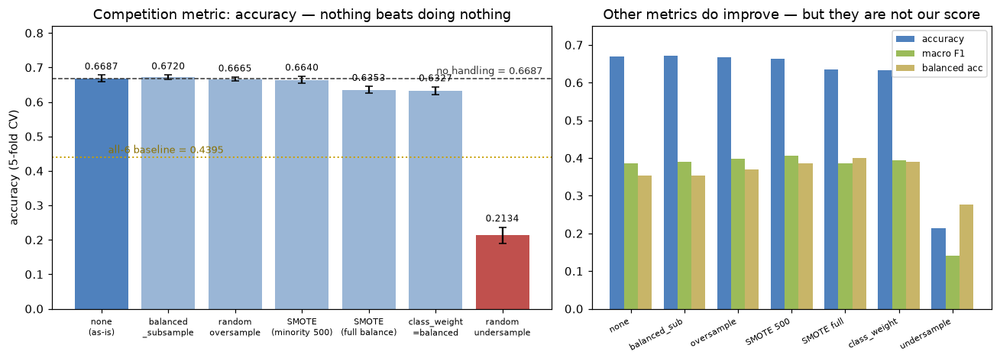
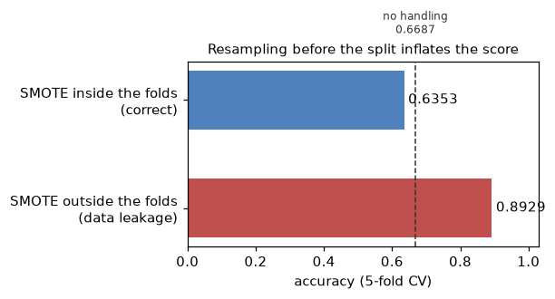

# 와인 품질 분류 — 불균형 처리, 할 것인가

ESAA YB 미니 프로젝트(2) — YB 2조

**질문**: 등급 분포가 심하게 치우쳐 있는데, 불균형 처리를 해야 하는가
**결론**: **공통 기본 설정으로는 적용하지 않는다.** 일곱 가지를 비교했는데 대회 지표인 정확도를 안정적으로 올린 방법이 없었다. 다만 `class_weight='balanced_subsample'`은 0.6720으로 기본(0.6687)보다 조금 높았으므로, 랜덤포레스트 담당자의 튜닝 후보로 남긴다.

---

## 1. 문제 상황

| 품질 | 병 수 | 비율 |
|---|---|---|
| 3 | 26 | 0.5% |
| 4 | 186 | 3.4% |
| 5 | 1,788 | 32.5% |
| 6 | **2,416** | **44.0%** |
| 7 | 924 | 16.8% |
| 8 | 152 | 2.8% |
| 9 | 5 | 0.1% |

5·6·7점이 전체의 **93.4%**를 차지하고, 양 끝인 3점과 9점은 합쳐서 31병뿐이다. 9점은 5병이라 5겹 교차검증을 하면 폴드마다 1병씩 들어간다.

이런 상황에서 모델은 소수 등급을 거의 맞히지 못한다. 그래서 보통 오버샘플링·언더샘플링·SMOTE·`class_weight` 같은 처리를 고려하게 되는데, **그 처리가 우리 점수를 올려주는지**를 실제로 확인했다.

---

## 2. 실험 설계

- 모델: `RandomForestClassifier(n_estimators=300, random_state=42)` 고정
- 검증: `StratifiedKFold(5, shuffle=True, random_state=42)`
- 피처: 원본 11개 + `is_white`
- 지표: 정확도(대회 지표), macro F1, balanced accuracy를 함께 측정

**리샘플링은 반드시 폴드 안에서 했다.** `imblearn.pipeline.Pipeline`을 써서 매 폴드의 학습 데이터에만 적용하고, 검증 데이터는 원래 분포 그대로 두었다. 이유는 5절에 적었다.

9점이 5병뿐이라 폴드 안에서는 4병까지 줄어들 수 있어, SMOTE의 `k_neighbors`는 기본값 5 대신 3으로 낮췄다.

---

## 3. 결과



| 방법 | 정확도 (대회 지표) | 비처리 대비 | macro F1 | balanced acc |
|---|---|---|---|---|
| **비처리 (그대로)** | **0.6687** (±0.0093) | — | 0.3866 | 0.3534 |
| `class_weight='balanced_subsample'` | 0.6720 (±0.0067) | +0.0033 | 0.3893 | 0.3528 |
| 랜덤 오버샘플링 | 0.6665 (±0.0059) | −0.0022 | 0.3975 | 0.3704 |
| SMOTE (소수 등급만 500개로) | 0.6640 (±0.0107) | −0.0047 | **0.4065** | 0.3850 |
| SMOTE (전체 균등) | 0.6353 (±0.0097) | −0.0335 | 0.3862 | **0.3999** |
| `class_weight='balanced'` | 0.6327 (±0.0114) | −0.0360 | 0.3944 | 0.3889 |
| 랜덤 언더샘플링 | **0.2134** (±0.0236) | **−0.4553** | 0.1408 | 0.2764 |

참고로 전부 6점으로 찍는 기준선이 **0.4395**다.

**정확도가 의미 있게 오른 방법은 없다.** 유일하게 비처리를 넘은 `balanced_subsample`의 +0.0033은 표준편차 ±0.009의 3분의 1이라 노이즈다. 게다가 이건 리샘플링이 아니라 트리마다 가중치를 다시 계산하는 옵션이라, "불균형 처리를 했다"고 보기도 애매하다.

**언더샘플링은 쓰면 안 된다.** 0.2134로 기준선(0.4395)의 절반도 안 된다. 다수 등급을 최소 등급 개수에 맞춰 깎기 때문에, 2,416병이던 6점이 9점 개수인 5병 수준으로 줄어든다. 5,497병짜리 데이터가 수십 병짜리가 되는 셈이다.

---

## 4. 왜 안 오르는가 — 지표의 문제

오른쪽 그래프를 보면 **다른 지표는 실제로 좋아진다.** macro F1은 SMOTE(소수만)가 0.4065로 비처리 0.3866보다 높고, balanced accuracy는 SMOTE(전체 균등)가 0.3999로 비처리 0.3534보다 훨씬 높다.

즉 불균형 처리는 **제 할 일을 하고 있다.** 소수 등급을 더 많이 맞히게 만들어 준다. 문제는 그 대가로 다수 등급을 틀린다는 것이다.

- macro F1 / balanced accuracy는 **등급마다 똑같은 비중**을 준다. 5병짜리 9점과 2,416병짜리 6점이 동등하다.
- 정확도는 **병 하나하나에 비중**을 준다. 6점 한 병을 더 맞히는 것과 9점 한 병을 더 맞히는 것의 값이 같다.

5·6·7점이 93.4%이므로, 정확도를 올리려면 **그 세 등급을 잘 맞히는 게 전부**다. 3점 26병을 전부 맞혀봐야 정확도는 0.5%p 오른다. 그 대가로 6점을 100병 틀리면 1.8%p를 잃는다.

> **대회 평가 산식이 ACCURACY라서 불균형 처리를 하지 않는 것이지, 불균형 처리가 나쁜 기법이라서가 아니다.** 만약 지표가 macro F1이었다면 정반대 결론이 나왔을 것이다.

---

## 5. 주의 — 폴드 밖에서 리샘플링하면 점수가 부풀려진다



| 방법 | 정확도 |
|---|---|
| SMOTE를 **먼저** 적용하고 교차검증 | **0.8929** ← 믿으면 안 되는 값 |
| SMOTE를 **폴드 안에서** 적용 | 0.6353 |
| 비처리 | 0.6687 |

0.89는 **데이터 누수로 만들어진 가짜 점수**다.

SMOTE는 소수 샘플들 사이를 보간해서 새 샘플을 만든다. 데이터를 나누기 전에 돌리면, 원본 A와 B 사이에서 만든 합성 샘플이 검증 폴드로 가고 A와 B는 학습 폴드에 남는 일이 생긴다. 모델은 이미 본 두 점의 중간값을 맞히는 것이라, 사실상 답을 알고 푸는 것과 같다.

0.6687짜리 문제에서 갑자기 0.89가 나오면 그건 성능 향상이 아니라 누수 신호로 봐야 한다. 리샘플링뿐 아니라 스케일링·인코딩·결측 대체도 같은 이유로 폴드 안에서 해야 한다.

```python
# 틀린 방법 — 나누기 전에 리샘플링
X_res, y_res = SMOTE().fit_resample(X, y)
cross_val_score(model, X_res, y_res, cv=cv)        # 0.8929

# 맞는 방법 — 폴드 안에서 리샘플링
from imblearn.pipeline import Pipeline
pipe = Pipeline([('smote', SMOTE()), ('model', model)])
cross_val_score(pipe, X, y, cv=cv)                  # 0.6353
```

---

## 정리

1. **공통 기본 설정에서는 불균형 처리를 하지 않는다.** 정확도를 안정적으로 올린 방법이 없다. `balanced_subsample`(0.6720)만 랜덤포레스트 담당자의 튜닝 후보로 남긴다.
2. **언더샘플링은 후보에서 제외한다.** 0.2134로 기준선의 절반도 안 된다.
3. **이유는 지표에 있다.** macro F1·balanced accuracy는 개선되지만 대회 지표는 정확도이고, 5·6·7점이 93.4%라 거기를 맞히는 게 점수다.
4. **리샘플링을 시도한다면 반드시 폴드 안에서.** 밖에서 하면 0.89 같은 가짜 점수가 나온다.
5. 다만 **발표에서는 "안 했다"가 아니라 "비교해보고 안 하기로 했다"**로 말할 수 있어야 하므로, 이 비교 자체가 결과물의 일부다.
