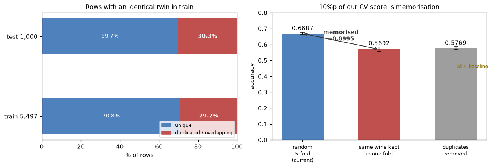

# 와인 품질 분류 — 중복 행, 우리 점수의 10%p는 암기다

ESAA YB 미니 프로젝트(2) — YB 2조

**발견**: train 5,497행 중 성분이 완전히 같은 중복이 858행 있고, 그 때문에 교차검증 점수가 약 10%p 부풀려져 있다.
**결론**: 그래도 **중복을 지우면 안 된다.** test의 30.3%가 train과 겹쳐서, 외우는 것이 리더보드 점수가 되기 때문이다.

모든 숫자는 `RandomForestClassifier(n_estimators=300, random_state=42)`, 5겹 교차검증 정확도다.

---

## 1. 중복 현황

성분 11개가 소수점까지 전부 같은 행들이 있다.

| 항목 | 값 |
|---|---|
| train 행 수 | 5,497 |
| **고유한 와인 종류** | **4,639** |
| 중복 행 | 858 |
| 중복에 얽힌 행 | 1,603 (**29.2%**) |
| 중복 그룹 중 등급이 엇갈리는 경우 | **0건** |

마지막 줄이 중요하다. 성분이 같은 와인들은 **품질 등급도 예외 없이 같았다.** 745개 중복 그룹 중 등급이 엇갈리는 그룹이 하나도 없다. 측정 오차로 우연히 값이 겹친 게 아니라, 같은 레코드가 여러 번 들어간 것이다.

원본 UCI 와인 품질 데이터에 원래 있던 중복이 그대로 넘어온 것으로 보인다.

---

## 2. 그래서 교차검증 점수가 부풀려진다

교차검증은 데이터를 5조각으로 **무작위로** 나눈다. 똑같은 와인이 두 개 있으면 하나는 학습 조각에, 하나는 검증 조각에 들어간다. 모델은 학습할 때 "이 성분 조합 = 6점"을 외우고, 검증할 때 똑같은 조합을 만나 그대로 맞힌다. 실력이 아니라 암기다.

같은 와인이 반드시 한 조각에만 들어가도록 묶어서 다시 쟀다.

| 검증 방식 | 정확도 |
|---|---|
| (a) 지금 쓰는 `StratifiedKFold` (무작위 분할) | **0.6687** (±0.0093) |
| (b) `StratifiedGroupKFold` (같은 와인을 한 폴드로) | **0.5692** (±0.0147) |
| (c) 중복을 지우고 학습 (4,639행) | 0.5769 (±0.0088) |

**(a) − (b) = +0.0995.** 우리가 써온 0.6687 중 약 10%p는 외운 것을 맞힌 몫이다.
처음 보는 와인에 대한 실제 실력은 0.57 수준이고, 이는 기준선(전부 6점, 0.4395)보다 0.13 높은 값이다.

---

## 3. 그런데 중복을 지우면 안 된다

test도 확인했다.

| 항목 | 값 |
|---|---|
| test 1,000병 중 train에 성분이 완전히 같은 병 | **303병 (30.3%)** |

**채점용 데이터의 30%가 train에 그대로 들어 있다.** 즉 모델이 train을 외우는 행위가 리더보드에서 실제로 점수가 된다. 중복을 지우면 그 303병을 맞힐 근거를 스스로 버리는 셈이고, 실제로 0.6687 → 0.5769로 떨어진다.

그리고 이 구조 때문에 **0.6687이 리더보드의 꽤 정확한 대리값이 된다.**

| | 겹침 비율 |
|---|---|
| 교차검증 검증 폴드 | 29.2% |
| 실제 test | 30.3% |

거의 같다. 검증 환경과 채점 환경의 구조가 우연히 일치해서, 지금의 교차검증 점수를 그대로 리더보드 예측에 쓸 수 있다.

### 조회로 답을 채우는 건 이득이 없다

test의 303병은 train에서 등급을 그대로 조회할 수 있다. 그래서 "모델 대신 조회값을 넣으면 점수가 오르지 않을까"를 모의실험했다. train을 8:2로 나눠 20%를 가짜 test로 삼고, 겹치는 행에서 모델 예측과 조회값을 비교했다.

| | 정확도 |
|---|---|
| 겹치는 병에서 **모델** 예측 | **1.0000** |
| 겹치는 병에서 **조회**값 | 1.0000 |
| 전체 정확도 (모델만) | 0.6664 |
| 전체 정확도 (조회 + 모델) | 0.6664 (**+0.0000**) |

**이득이 정확히 0이다.** 그 병들은 학습 데이터에 있으므로 모델이 이미 100% 맞히고 있다. 조회 로직을 따로 만들 필요가 없다.

---

## 4. 모델 순위도 다시 확인했다

점수가 암기로 채워져 있다면, 모델 순위도 "누가 더 잘 외우나"를 재고 있을 수 있다. 그래서 두 가지 검증을 같이 돌렸다. 피처는 원본 11개 + `is_white` + 결합 이산화황이다.

| 모델 | 일반 CV (리더보드용) | 그룹 CV (처음 보는 와인) | 암기 몫 |
|---|---|---|---|
| 엑스트라 트리 | **0.6798** (±0.0112) | 0.5739 (±0.0098) | +0.1059 |
| 랜덤포레스트 | 0.6735 (±0.0077) | **0.5750** (±0.0084) | +0.0984 |
| XGBoost | 0.6540 (±0.0123) | 0.5385 (±0.0155) | +0.1155 |
| LightGBM | 0.6513 (±0.0107) | 0.5463 (±0.0060) | +0.1050 |

- **엑스트라 트리와 랜덤포레스트는 사실상 동률이다.** 일반 CV는 ET가, 그룹 CV는 RF가 앞서지만 둘 다 표준편차 안이다. 어느 쪽도 암기로 순위를 얻은 게 아니다.
- **XGBoost와 LightGBM은 순위가 뒤집힌다.** 일반 CV는 XGBoost, 그룹 CV는 LightGBM이 앞선다. 차이가 작아 어느 쪽을 써도 무방하다.
- 네 모델의 암기 몫이 +0.098 ~ +0.116으로 비슷하다. 특정 모델만 유리하게 작용한 건 아니다.

---

## 정리

1. **중복 행은 그대로 둔다.** 지우면 0.6687 → 0.5769로 떨어진다. 데이터 정제의 상식과 반대지만, test의 30.3%가 train과 겹치는 이 대회에서는 지우는 쪽이 손해다.
2. **조회 로직은 만들지 않는다.** 겹치는 병은 모델이 이미 100% 맞히고 있어 이득이 0이다.
3. **점수는 두 가지를 같이 본다.** 리더보드 예측은 일반 CV, 처음 보는 와인에 대한 실력은 그룹 CV.
4. **모델 순위는 믿을 만하다.** 엑스트라 트리와 랜덤포레스트가 동률 1위이고, 두 검증 방식에서 모두 상위다.
5. **발표에서 "정확도 0.67"만 말하지 않는다.** 10%p가 암기라는 구조를 같이 설명해야 한다. 모르고 넘어가면 지적받을 지점이고, 알고 설명하면 오히려 데이터를 깊이 본 근거가 된다.
