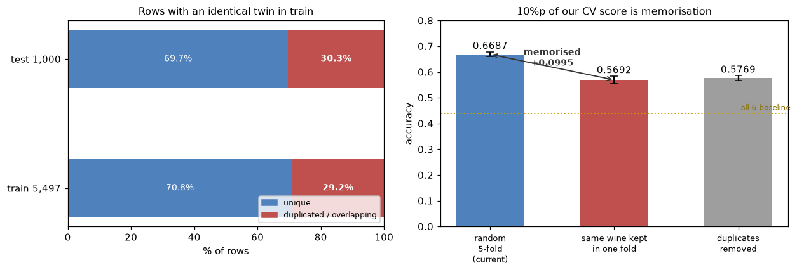

# 와인 품질 분류 — 11/6 회의 자료

ESAA YB 미니 프로젝트(2) — YB 2조 (승주 · 희경 · 경서 · 민서)

**오늘 정할 세 가지** — 공통으로 적용할 전처리, 앞으로 각자 맡을 작업, 제출 일정.

| 순서 | 안건 | 시간 |
|---|---|---|
| ① | EDA 공유 | 20분 |
| ② | 공통 검증 규칙 | 5분 |
| ③ | 중복 데이터 | 3분 |
| ④ | 전처리 결정 | 15분 |
| ⑤ | 모델과 역할 분담 | 5분 |
| ⑥ | 일정 확정 | 5분 |

모든 숫자는 `StratifiedKFold(5, shuffle=True, random_state=42)` 교차검증 정확도이고,
비교 모델은 `RandomForestClassifier(n_estimators=300, random_state=42)`다.
기준선(전부 6점으로 예측)은 **0.4395**다.

---

# ① EDA 공유

한 사람당 5분. 그래프 설명보다 **"무엇을 발견했고, 그래서 전처리를 어떻게 하자"** 순서로.

| 담당 | 자료 |
|---|---|
| 승주 — 변수 간 상관 | [1103_wine_corr_EDA.md](1103_ESAA_YB_wine_corr_EDA.md) |
| 희경 — 등급별 차이 | (공유 문서 6절) |
| 경서 — | (요약 미공유, 회의에서 확인) |
| 민서 — | |

## 승주 담당분 요약

**1. 상관계수가 작다는 이유로 변수를 빼지는 말자**

선형 상관이 뚜렷한 변수는 알코올(+0.44), 밀도(−0.30), 휘발산(−0.26), 염화물(−0.20) 네 개뿐이고
나머지 일곱 개는 |r| ≤ 0.08이다. 그 일곱 개를 빼고 돌려보니 **0.6687 → 0.6427**로 약 2.6%p 떨어졌다.

상관이 작다는 건 선형 관계가 약하다는 뜻이지 예측에 쓸모가 없다는 뜻이 아니다.
상호정보량으로 비교하면 잔당이 6계단, 총 이산화황이 4계단 올라온다.
→ **상관계수는 관계를 보는 데 쓰고, 변수 제거는 검증 결과로 판단한다.**

**2. 결합 이산화황을 파생변수로 추가하자**

유리 SO₂와 총 SO₂는 r = +0.717이고, 총량이 유리분을 **포함**하는 관계다.
`총 SO₂ − 유리 SO₂ = 결합 이산화황`으로 분리하면 중복이 풀린다.

밀도는 다르다. 다른 성분과 겹치는 정보가 많아(VIF 15.5) 제외 후보지만,
**모델마다 결과가 갈린다.** 공통 삭제 대신 담당자가 비교한다.

**3. 와인 종류를 변수로 유지하자**

| 변수 | 전체 | red | white |
|---|---|---|---|
| citric acid | +0.079 | **+0.201** | −0.005 |
| sulphates | +0.042 | **+0.258** | +0.056 |
| fixed acidity | −0.077 | **+0.116** | **−0.107** |
| pH | +0.018 | **−0.041** | **+0.091** |

전체에서 보이는 관계와 red·white를 나눴을 때의 관계가 다르다. 네 변수는 방향까지 반대다.
**희경님 등급별 EDA에서 황산염·시트르산이 red에서만 뚜렷하다고 하신 결과와 같은 방향이다.**

→ `is_white`로 넣되 모델은 통합. 분리 0.6722 vs 통합 0.6687은 표준편차(±0.012) 안이라
분리가 안정적으로 낫다고 보기 어렵다.

---

# ② 공통 검증 규칙

**1. 교차검증 설정을 통일한다** — `StratifiedKFold`, 5겹, `shuffle=True`, `random_state=42`.
**같은 행 순서의 데이터**로 시작해야 검증 폴드까지 같아진다. `random_state`만 맞춰도 행 순서가
다르면 폴드가 달라진다.

**2. 평균과 함께 폴드별 점수도 남긴다.** 평균이 조금 올랐을 때 다섯 폴드에서 고르게 좋아진 것인지
한 폴드가 끌어올린 것인지 구분해야 한다.

**3. 비교 기준은 0.4395**(전부 6점). test 1,000개는 정답이 없으므로 모델 간 비교는 교차검증으로 하고,
제출 점수는 별도로 기록한다.

**4. 데이터에서 기준을 학습하는 처리는 폴드 안에서 한다.**

| 폴드 안에서 해야 하는 것 | 미리 적용해도 되는 것 |
|---|---|
| 리샘플링, 스케일링, 결측 대체 | `is_white` 변환 |
| — 전체 분포나 정답을 참고해 기준을 정함 | `총 SO₂ − 유리 SO₂` |
| 리샘플링은 `imblearn.Pipeline`으로 묶기 | — 다른 행의 값을 참고하지 않음 |

폴드 밖에서 리샘플링하면 점수가 부풀려진다. SMOTE를 미리 돌리면 0.6353이 **0.8929**로 뛴다.
이 값은 검증의 독립성이 깨진 결과라 모델 비교에 쓰면 안 된다.

---

# ③ 중복 데이터

→ [상세 문서](1106_ESAA_YB_wine_duplicates.md)

## 현황

| 항목 | 값 |
|---|---|
| train 행 수 | 5,497 |
| 성분 11개 기준 고유한 조합 | **4,639** |
| 중복을 하나씩만 남길 때 제외되는 행 | 858 |
| 중복 그룹에 속한 행 | 1,603 (**약 29%**) |
| 중복 그룹 안에서 등급이 엇갈리는 경우 | **없음** |

## 검증에 미치는 영향

무작위 교차검증은 같은 성분의 행을 학습과 검증에 나눠 넣는다. 그러면 검증 점수에
"처음 보는 조합을 예측하는 성능"과 "학습에서 본 조합을 맞히는 성능"이 함께 반영된다.

| 검증 방식 | 정확도 |
|---|---|
| (a) 무작위 분할 `StratifiedKFold` | **0.6687** (±0.0093) |
| (b) 같은 조합을 한 폴드로 `StratifiedGroupKFold` | **0.5692** (±0.0147) |
| (c) 중복을 지우고 학습 (4,639행) | 0.5769 (±0.0088) |

약 **10%p** 차이다. 다만 이 차이 전체를 암기 효과라고 단정하기는 어렵다.
그룹으로 묶으면 폴드 구성이 달라지고 등급 분포도 덜 고르게 나뉜다.
그래도 **중복의 폴드 간 겹침이 점수에 상당한 영향을 준다**는 것은 확인된다.

## 그렇다고 지우면 안 된다

| 항목 | 값 |
|---|---|
| test 1,000개 중 train과 성분값이 완전히 같은 행 | **303개 (30.3%)** |

test에도 학습에서 본 조합이 상당수 포함돼 있다. 지우면 0.6687 → 0.5769로 떨어진다.

검증 폴드의 겹침(29%)과 test의 겹침(30%)이 비슷하다는 점은 참고할 수 있지만,
그것만으로 교차검증 점수가 제출 점수와 같다고 보장할 수는 없다.
겹치지 않는 70%의 난이도가 같다는 보장이 없다. **11/11 1차 제출 때 실제 차이를 확인한다.**

> `test`를 `train`에서 조회해 답을 채우는 것도 모의실험했으나 **이득이 0이었다.**
> 겹치는 행은 모델이 이미 100% 맞히고 있어 따로 손댈 필요가 없다.

## 발표할 때

"정확도 0.67 달성"으로 끝내지 않고, **일반 교차검증 약 0.67 / 같은 성분 조합을 분리한
그룹 검증 약 0.57**이라고 평가 조건을 함께 밝힌다.

---

# ④ 전처리 결정

| | 안건 | 제안 | 근거 |
|---|---|---|---|
| 1 | 중복 행 | **유지**, 최종 후보는 그룹 검증도 기록 | 지우면 0.6687 → 0.5769 |
| 2 | 불균형 처리 | **공통 기본은 미적용** | 아래 표 |
| 3 | red·white | **`is_white`로 넣고 모델은 통합** | 분리 0.6722 vs 통합 0.6687, 오차범위 |
| 4 | 결합 이산화황 | **공통 추가** | 네 모델 전부 상승 |
| 5 | 밀도 | **공통 삭제 안 함, 담당자가 비교** | RF는 이득, ET는 손해 |

## 2번 — 불균형 처리 상세

→ [상세 문서](1103_ESAA_YB_wine_imbalance.md)

| 방법 | 정확도 | 기본 대비 |
|---|---|---|
| **기본 (미적용)** | **0.6687** | — |
| `class_weight='balanced_subsample'` | 0.6720 | **+0.0033** |
| 랜덤 오버샘플링 | 0.6665 | −0.0022 |
| SMOTE (소수만 500개로) | 0.6640 | −0.0047 |
| SMOTE (전체 균등) | 0.6353 | −0.0335 |
| `class_weight='balanced'` | 0.6327 | −0.0360 |
| 랜덤 언더샘플링 | 0.2134 | −0.4553 |

**모든 방법이 낮아진 것은 아니다.** `balanced_subsample`은 기본보다 조금 높았지만
차이가 표준편차(±0.009) 안이라 안정적인 개선으로 보기 어렵다.
→ **공통 기본은 미적용, `balanced_subsample`은 랜덤포레스트 담당자의 튜닝 후보.**

일부 처리에서 macro F1과 balanced accuracy는 좋아졌다. 등급별 성능을 고르게 만드는 데는
도움이 되지만, 이번 대회 지표인 전체 정확도의 개선으로는 이어지지 않았다.

**불균형 처리 비교를 다시 맡을 사람은 필요 없다.** 이 결과를 공통 자료로 쓴다.

## 4·5번 — 피처 구성별 점수

| 피처 구성 | 엑스트라 트리 | 랜덤포레스트 | XGBoost | LightGBM |
|---|---|---|---|---|
| **A** 원본 + `is_white` | 0.6765 | 0.6687 | 0.6505 | 0.6493 |
| **B** A + 결합 SO₂ | **0.6798** | 0.6735 | **0.6540** | **0.6513** |
| **C** B − density | 0.6764 | **0.6764** | 0.6514 | 0.6509 |

결합 SO₂는 네 모델 전부에서 올랐다. density 제외는 RF에서만 이득이다.

## 그 밖의 제안

이상치 처리나 변환도 같은 기준으로 정한다. 그래프에서 특이해 보인다는 이유만으로 일괄 삭제하지 않고,
**처리 전후의 검증 결과를 비교해 효과가 확인된 것만 적용한다.**

참고로 희경님이 인접 등급끼리 분포가 크게 겹친다고 하셨는데, 그러면 오분류가 주로 5↔6, 6↔7에서
난다는 뜻이다. 소수 등급을 늘려도 점수가 안 오른 불균형 실험 결과와 같은 방향이다.
**문제는 3점·9점이 아니라 중간 등급 경계다.**

---

# ⑤ 모델과 역할 분담

## 모델 선택 근거

| 모델 | 일반 CV | 그룹 CV (처음 보는 조합) |
|---|---|---|
| 엑스트라 트리 | **0.6798** (±0.0112) | 0.5739 (±0.0098) |
| 랜덤포레스트 | 0.6735 (±0.0077) | **0.5750** (±0.0084) |
| XGBoost | 0.6540 (±0.0123) | 0.5385 (±0.0155) |
| LightGBM | 0.6513 (±0.0107) | 0.5463 (±0.0060) |

- **ET와 RF는 사실상 동률.** 일반 CV는 ET, 그룹 CV는 RF가 앞서지만 둘 다 표준편차 안이다.
- **XGBoost와 LightGBM은 순위가 뒤집힌다.** 차이가 작아 어느 쪽을 써도 무방하다.
  XGBoost 튜닝이 안 풀리면 LightGBM으로 바꿔도 된다.
- 제외: 로지스틱 회귀 0.5419, GBM 0.5869.

**앙상블**: ET + RF + LightGBM 소프트 보팅은 **0.6625**로 단일 최고(0.6798)보다 낮았다.
성능 차가 큰 모델을 섞으면 못하는 쪽이 끌어내린다. **점수가 비슷한 ET + RF만 묶는 쪽**을 먼저 본다.

## 분담

| 담당 | 할 일 |
|---|---|
| 엑스트라 트리 | 파라미터 조정 + density 포함/제외 비교 |
| 랜덤포레스트 | 위와 같음 + `balanced_subsample` 후보 확인 |
| XGBoost | 위와 같음 |
| 공통 통합 | 파생변수 공통 검증, 보팅 비교, 제출 형식 점검, README |

- 모델 담당 세 명은 **같은 기본 변수와 같은 검증 설정**에서 시작한다.
- 새 파생변수를 제안할 때는 **계산식과 추가 전후 점수**를 같이 남긴다.
- **GitHub 정리는 각자 맡은 실험까지 직접** 한다. 본인 노트북에 사용 변수·모델 설정·교차검증
  결과를 적고, 통합 담당자는 README와 제출 실행 순서만 정리한다. 한 명에게 몰리지 않게.
- 스태킹은 개별 모델과 보팅까지 확인한 뒤 시간이 남으면.

---

# ⑥ 일정

| 날짜 | 할 일 |
|---|---|
| **11/10 (화)** | 각 모델 1차 튜닝 결과 공유 — 점수·사용 변수·모델 설정 |
| **11/11 (수)** | **리더보드 1차 제출** — 형식 점검 + CV와 제출 점수 차이 확인 |
| 11/12 (목) | 개별 모델·앙상블 비교해 최종 모델 확정 |
| 11/13 (금) | 제출 완료 (링크 + 점수) |
| 11/14~15 (주말) | 발표 자료 |
| **11/16 (월) 18:00** | 자료 마감 |

**주의** — 11/9(월) 18시가 캐글 필사 마감이라 주말에 다들 바쁘다. 11/10이 빠듯하면 11/11 오전까지
미뤄도 된다. 11/13(금)은 회귀 필사 마감도 겹치므로 프로젝트는 그 전에 끝내는 게 안전하다.

## 실험하면서 같이 기록할 세 가지

1. 무엇을 바꿨는지
2. 점수가 어떻게 달라졌는지
3. 그래서 최종적으로 무엇을 선택했는지

**성능이 떨어진 실험도 선택의 근거가 되므로 결과를 남긴다.** 발표 자료의 절반이 여기서 나온다.

---

# 오늘 결정한 것

- 중복 행은 **유지**. 일반 교차검증을 공통 비교 기준으로 쓰되, 최종 후보는 그룹 검증도 함께 확인
- 불균형 처리는 **공통 기본 미적용**. `balanced_subsample`만 RF 담당자 튜닝 후보
- red·white는 **`is_white`를 넣어 통합**
- **결합 이산화황은 공통 추가**
- **밀도 제외 여부는 모델별로 비교**
- 모델 담당: 엑스트라 트리 ○○ / 랜덤포레스트 ○○ / XGBoost ○○ / 통합 ○○
- 11/10 1차 결과 공유, 11/11 첫 제출
